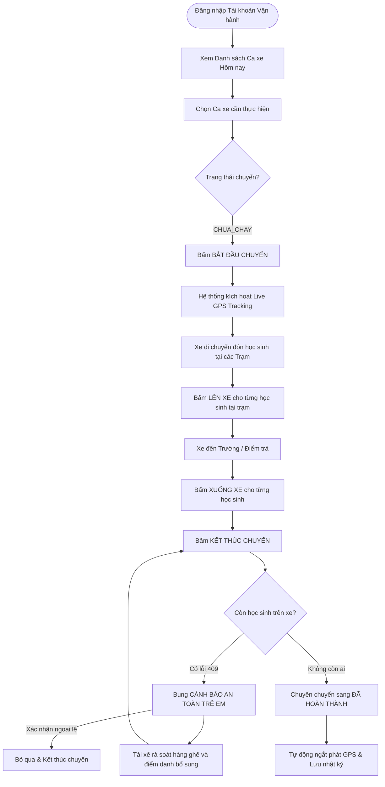

# HƯỚNG DẪN SỬ DỤNG VÀ QUY TRÌNH VẬN HÀNH ĐIỂM DANH XE TRƯỜNG
## PHÂN HỆ VẬN HÀNH CA XE & ĐIỂM DANH HỌC SINH (APP ADMIN - FLUTTER)

> **Dự án**: Hệ thống Quản lý và Vận chuyển Học sinh bằng Xe buýt Trường học (BusCare)  
> **Thành viên thực hiện**: Thành viên 3 (Phân hệ Mobile Admin / Nhân viên Vận hành)  
> **Nền tảng**: Flutter (Dart) — Hỗ trợ Android Phone & Tablet  
> **Backend API**: Node.js / Express RESTful API trên Render (`https://nh-m-4-dai-bat-on.onrender.com`)  
> **Cơ sở dữ liệu**: PostgreSQL / Supabase  

---

## I. TỔNG QUAN PHÂN HỆ VẬN HÀNH

Phân hệ Vận hành và Điểm danh trên ứng dụng **BusCare Admin** được thiết kế chuyên biệt dành cho **Tài xế (`TAI_XE`)** và **Bảo mẫu (`BAO_MAU`)** để quản lý ca trực thực tế trên xe buýt trường học hàng ngày.

### 1. Mục tiêu cốt lõi
1. **Điểm danh chính xác hai chiều**: Điểm danh **LÊN XE** tại từng trạm đón và điểm danh **XUỐNG XE** tại cổng trường hoặc trạm trả.
2. **Tuyệt đối không bỏ quên trẻ trên xe**: Tích hợp cơ chế cảnh báo an toàn chặn kết thúc chuyến (HTTP 409 Conflict) và hiển thị hộp thoại cảnh báo khẩn cấp danh sách học sinh còn sót lại trên xe.
3. **Định vị Live GPS thời gian thực**: Tự động phát tọa độ xe theo chu kỳ khi chuyến đang chạy để phụ huynh và nhà trường theo dõi trực tiếp lộ trình trên bản đồ.
4. **Tối ưu trải nghiệm thực địa**: Thích ứng xoay ngang màn hình (Landscape Master-Detail) khi gắn điện thoại/máy tính bảng lên táp-lô xe, tự động lưu giữ trạng thái cuộn và dữ liệu không bị mất.

---

## II. SƠ ĐỒ QUY TRÌNH VẬN HÀNH (WORKFLOW)



---

## III. HƯỚNG DẪN THAO TÁC CHI TIẾT TỪNG BƯỚC

### Bước 1: Đăng nhập phân quyền nhân viên vận hành
1. Mở ứng dụng **BusCare Admin**.
2. Nhập thông tin tài khoản nhân viên vận hành:
   - **Tài khoản Tài xế**: `taixe@xetruong.vn` / Mật khẩu: `123456`
   - **Tài khoản Bảo mẫu**: `baomau@xetruong.vn` / Mật khẩu: `123456`
3. Hệ thống kiểm tra vai trò:
   - Tài khoản có quyền `TAI_XE` hoặc `BAO_MAU` sẽ được tự động điều hướng vào giao diện chuyên biệt **Vận hành Ca xe (`VanHanhShell`)**.
   - Nếu đăng nhập bằng tài khoản Quản lý (`ADMIN`), hệ thống sẽ mở phân hệ Quản lý Tuyến và Báo cáo hạm đội.

### Bước 2: Tiếp nhận ca xe trong ngày
1. Tại tab **Ca xe hôm nay**, màn hình hiển thị thẻ thông tin ca trực:
   - Tên tuyến đường (ví dụ: *Tuyến Q1 - Bình Thạnh*).
   - Biển số xe được phân công (ví dụ: *51B-888.99*).
   - Chiều chuyến: **ĐÓN SÁNG** hoặc **TRẢ CHIỀU**.
   - Trạng thái hiện tại: **Chưa chạy** (Cam), **Đang chạy** (Xanh lá), **Đã hoàn thành** (Xanh ngọc).
2. Chạm vào thẻ ca xe để mở màn hình **Chi tiết chuyến đi**.

### Bước 3: Bắt đầu chuyến xe & Kích hoạt định vị GPS
1. Khi xe chuẩn bị xuất bến, bấm nút **"BẮT ĐẦU CHUYẾN"** màu xanh dương.
2. Hộp thoại xác nhận hiển thị: Chọn **"Bắt đầu"**.
3. Hệ thống gửi yêu cầu lên máy chủ:
   - Trạng thái chuyến chuyển sang **Đang chạy**.
   - Thẻ **GPS LIVE TRACKING** tự động kích hoạt: Đèn xanh nhấp nháy, hiển thị tọa độ GPS thời gian thực và tốc độ di chuyển.
   - Tọa độ GPS sẽ tự động được gửi lên server định kỳ mỗi 5 giây để phụ huynh theo dõi vị trí xe.
   - Tài xế có thể bấm nút **"Gửi vị trí ngay"** nếu muốn cập nhật tức thì tọa độ hiện tại.

### Bước 4: Điểm danh đón học sinh LÊN XE tại từng trạm
1. Mở tab **"Điểm dừng"**:
   - Xem lộ trình trục dọc (Timeline Stepper) gồm các trạm đón theo thứ tự.
   - Chạm vào trạm dừng để xem danh sách các em học sinh đăng ký tại trạm đó.
2. Mở tab **"Học sinh"**:
   - Sử dụng thanh tìm kiếm để tìm nhanh học sinh theo Tên, Lớp hoặc Mã học sinh.
   - Sử dụng các chip lọc: *Chưa lên*, *Đang trên xe*, *Đã xuống*, *Báo nghỉ*.
   - Với học sinh có đơn xin nghỉ phép (hiển thị nhãn *Nghỉ có phép* màu cam gạch ngang tên kèm lý do), hệ thống tự động ẩn nút điểm danh để tránh bấm nhầm.
   - Khi học sinh bước lên xe, nhân viên bấm nút **"LÊN XE"** màu xanh dương:
     - Hệ thống gửi request API ghi nhận sự kiện `LEN_XE`.
     - Thẻ học sinh lập tức đổi sang trạng thái **"Đang trên xe"** màu xanh dương và nút tự động đổi thành **"XUỐNG XE"**.

### Bước 5: Điểm danh trả học sinh XUỐNG XE tại trường / điểm trả
1. Khi xe đến cổng trường (chiều đón sáng) hoặc đến trạm trả (chiều trả chiều):
2. Tại tab **"Học sinh"**, chọn chip lọc **"Đang trên xe"** để hiển thị tất cả các em đang có mặt trên xe.
3. Khi học sinh bước xuống xe an toàn, nhân viên bấm nút **"XUỐNG XE"** màu xanh lá:
   - Hệ thống ghi nhận sự kiện `XUONG_XE`.
   - Thẻ học sinh cập nhật sang trạng thái **"Hoàn tất"** kèm biểu tượng tích xanh.
   - **Ràng buộc an toàn**: Học sinh chưa từng được điểm danh LÊN XE sẽ không thể bấm XUỐNG XE (hệ thống sẽ hiển thị cảnh báo chặn).

### Bước 6: Kiểm tra an toàn phòng chống bỏ quên học sinh trên xe
1. Sau khi trả học sinh, nhân viên bấm nút **"KẾT THÚC CHUYẾN"** màu đỏ.
2. **Cơ chế An toàn Nghiêm ngặt (Safety Gate)**:
   - Nếu vẫn còn học sinh đang trên xe chưa được điểm danh xuống, máy chủ sẽ trả về mã lỗi `409 Conflict`.
   - Ứng dụng lập tức bung hộp thoại **"CẢNH BÁO AN TOÀN TRẺ EM"** màu đỏ khẩn cấp:
     - Nhắc nhở nhân viên: *"Còn học sinh chưa được xác nhận xuống xe! Hãy kiểm tra kỹ tất cả các hàng ghế trước khi rời xe để đảm bảo không bỏ quên học sinh!"*.
     - Liệt kê cụ thể họ tên và lớp của từng em học sinh còn sót lại.
   - Nhân viên chọn:
     - **"Kiểm tra lại xe"**: Đóng hộp thoại để xuống xe rà soát thực tế từng hàng ghế và hoàn tất điểm danh xuống xe.
     - **"Bỏ qua & Kết thúc"**: Chỉ sử dụng trong trường hợp bất khả kháng khi đã xác minh trực tiếp với phụ huynh/nhà trường.

### Bước 7: Kết thúc chuyến xe
1. Khi tất cả học sinh đã xuống xe an toàn, bấm **"KẾT THÚC CHUYẾN"**.
2. Hệ thống chuyển trạng thái chuyến đi sang **"Đã hoàn thành"**.
3. Dịch vụ GPS Tracker tự động ngừng phát sóng để tiết kiệm pin thiết bị và tài nguyên mạng.

---

## IV. CÁC TÍNH NĂNG NÂNG CAO ĐÃ TRIỂN KHAI

| Tính năng | Mô tả kỹ thuật | Lợi ích vận hành |
| :--- | :--- | :--- |
| **Bố cục Xoay ngang (Landscape Mode)** | Sử dụng `OrientationBuilder` chia giao diện thành 2 cột Master-Detail khi xoay ngang máy | Tối ưu hiển thị hoàn hảo khi tài xế gắn điện thoại/tablet nằm ngang trên táp-lô xe buýt, không bị lỗi tràn màn hình (overflow) |
| **Chống mất dữ liệu (State Preservation)** | Tích hợp `AutomaticKeepAliveClientMixin` và `PageStorageKey` | Giữ nguyên từ khóa tìm kiếm, vị trí cuộn và các trạm đang mở rộng khi người dùng chuyển qua lại giữa các tab |
| **Tự động ngắt phiên (401 Interceptor)** | `AuthHttpInterceptor` bắt mã lỗi 401 Unauthorized trên toàn bộ các API gọi đi | Tự động đăng xuất và xóa Token an toàn khi phiên đăng nhập hết hạn |
| **Mô phỏng GPS thực tế** | Thuật toán nội suy tọa độ bám sát các trạm dừng của tuyến | Cho phép demo trơn tru trên thiết bị giả lập (Emulator) mà không cần di chuyển xe thực tế ngoài đường |

---

## V. HƯỚNG DẪN BIÊN DỊCH VÀ CÀI ĐẶT FILE APK RELEASE

### 1. Yêu cầu môi trường
- Flutter SDK version >= 3.13.0
- Android SDK version >= 34
- Java Development Kit (JDK) 17

### 2. Các câu lệnh biên dịch (Build APK)

Mở terminal tại thư mục dự án `admin-flutter` và chạy một trong các lệnh sau:

* **Cách 1: Biên dịch file APK Release chuẩn (Universal APK)**:
  ```powershell
  flutter build apk --release
  ```
  File cài đặt xuất ra tại:  
  `admin-flutter/build/app/outputs/flutter-apk/app-release.apk`

* **Cách 2: Biên dịch file APK tối ưu dung lượng theo từng chip (Split per ABI)**:
  ```powershell
  flutter build apk --split-per-abi --release
  ```
  File cài đặt cho chip ARM64 (hầu hết điện thoại Android hiện nay):  
  `admin-flutter/build/app/outputs/flutter-apk/app-arm64-v8a-release.apk`

### 3. Cài đặt trực tiếp lên điện thoại Android
1. Kết nối điện thoại Android với máy tính qua cáp USB và bật chế độ **Gỡ lỗi USB (USB Debugging)**.
2. Chạy lệnh cài đặt trực tiếp:
   ```powershell
   flutter install
   ```
   Hoặc copy file `app-release.apk` vào bộ nhớ điện thoại và mở file để tiến hành cài đặt.

---

## VI. DANH MỤC TÀI KHOẢN THỬ NGHIỆM

| STT | Vai trò | Email đăng nhập | Mật khẩu | Phạm vi chức năng |
| :---: | :--- | :--- | :---: | :--- |
| 1 | **Tài xế (`TAI_XE`)** | `taixe@xetruong.vn` | `123456` | Tiếp nhận ca xe, phát GPS Live, điểm danh đón/trả học sinh |
| 2 | **Bảo mẫu (`BAO_MAU`)** | `baomau@xetruong.vn` | `123456` | Điểm danh học sinh tại các trạm, xem đơn báo nghỉ, cảnh báo an toàn |
| 3 | **Quản trị (`ADMIN`)** | `admin@xetruong.vn` | `123456` | Quản lý hạm đội xe, quản lý tuyến đường, xem báo cáo tổng hợp |
